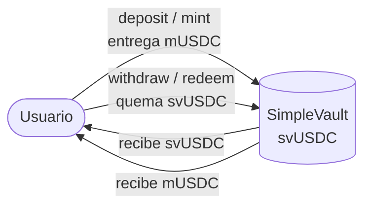
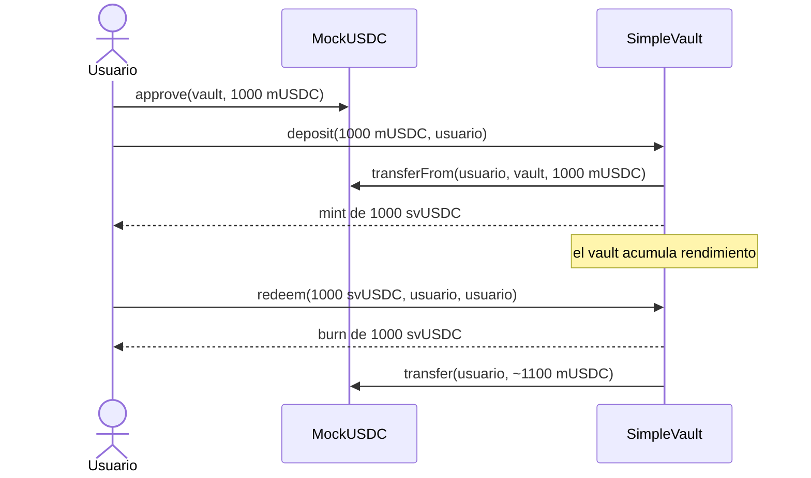
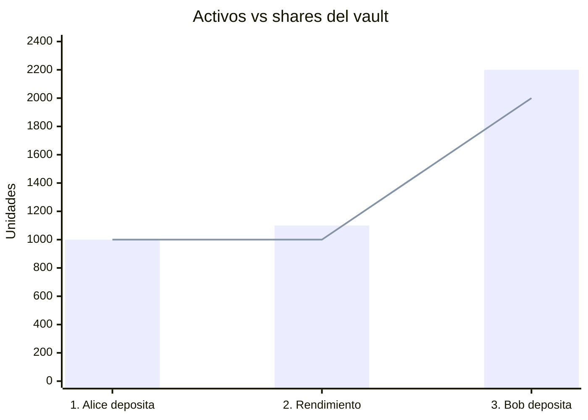

# Vault ERC-4626

Vault ERC-4626 de ejemplo para clase, con un frontend para depositar y retirar en una red local.

- `src/MockUSDC.sol`: token ERC-20 de prueba con 6 decimales (mUSDC).
- `src/SimpleVault.sol`: vault ERC-4626 sobre mUSDC (OpenZeppelin v5, offset de decimales 6).
- `script/Deploy.s.sol`: despliega ambos contratos en Anvil, mintea 10.000 mUSDC a la cuenta #0 y escribe las direcciones en `web/src/addresses.json`.
- `web/`: frontend en Vite + React + TypeScript + wagmi + viem.

## ¿Qué es ERC-4626?

[ERC-4626](https://eips.ethereum.org/EIPS/eip-4626) es el estándar de **vaults tokenizados**. Un vault recibe un token ERC-20 (el **activo**, acá mUSDC) y a cambio entrega **shares**, que son a su vez un token ERC-20 (acá svUSDC). Las shares representan una parte proporcional de todo lo que hay en el vault.



La idea central es que **el precio de una share no es fijo**:

```
precio de la share = totalAssets() / totalSupply()
```

Si el vault gana rendimiento, `totalAssets()` sube y la cantidad de shares no cambia, así que cada share pasa a valer más activos. Esa es la forma en que un vault reparte ganancias entre sus depositantes sin tocar sus balances.

### Las cuatro acciones

El estándar define dos formas de entrar y dos de salir, según qué cantidad querés fijar:

| Acción | Fijás | El vault calcula | Redondeo |
| --- | --- | --- | --- |
| `deposit(assets)` | activos que entregás | shares que recibís | hacia abajo |
| `mint(shares)` | shares que querés | activos que pagás | hacia arriba |
| `withdraw(assets)` | activos que sacás | shares que se queman | hacia arriba |
| `redeem(shares)` | shares que quemás | activos que recibís | hacia abajo |

El redondeo siempre favorece al vault (es decir, al resto de los depositantes) y nunca al usuario que opera. Si fuera al revés, alguien podría repetir operaciones chicas y extraer valor de a centavos. Cada acción tiene su `preview*` (`previewDeposit`, `previewMint`, etc.) que devuelve el resultado exacto antes de ejecutarla.

### Flujo de un depósito y un retiro

El frontend usa `deposit` para entrar y `redeem` para salir. Como el vault tiene que mover tus mUSDC, primero hay que aprobarlo:



### Ejemplo: cómo se reparte el rendimiento

SimpleVault no genera rendimiento solo, pero se puede simular transfiriéndole mUSDC directamente (sin pasar por `deposit`). Así sube `totalAssets()` sin emitir shares nuevas.

1. **Alice deposita 1000 mUSDC** en el vault vacío y recibe 1000 svUSDC. Precio: 1,00.
2. **Entran 100 mUSDC de rendimiento.** Hay 1100 mUSDC y 1000 svUSDC. Precio: 1,10. Las shares de Alice ahora valen 1099,999999 mUSDC; el último decimal se pierde por el redondeo hacia abajo.
3. **Bob deposita 1100 mUSDC.** Como cada share vale 1,10, recibe 1000 svUSDC. Hay 2200 mUSDC y 2000 svUSDC, y el precio sigue en 1,10: Bob no se lleva nada del rendimiento que ganó Alice antes de que él entrara.



Las barras son `totalAssets()` (mUSDC) y la línea es `totalSupply()` (svUSDC). La distancia entre las dos es el rendimiento acumulado.

Para simularlo en Anvil, con las direcciones de `web/src/addresses.json`:

```shell
cast send <mockUSDC> "transfer(address,uint256)" <simpleVault> 100000000 \
  --rpc-url anvil --private-key $PRIVATE_KEY   # 100 mUSDC (6 decimales)
```

### Protección contra el ataque de inflación

Con un vault vacío, un atacante puede depositar 1 unidad mínima, donar una suma grande directamente al vault para inflar el precio de la share y así hacer que el depósito de la próxima víctima redondee a casi cero shares.

OpenZeppelin lo mitiga sumando **shares y activos virtuales** a la cuenta (`totalSupply() + 10 ** offset` y `totalAssets() + 1`). SimpleVault usa un offset de 6, por eso svUSDC tiene 12 decimales (6 de mUSDC + 6). Simulando el ataque con la fórmula del contrato (el atacante deposita 1 unidad y dona 10.000 mUSDC, y después la víctima deposita 10.000 mUSDC):

| Offset | La víctima recupera | El atacante recupera (de 10.000 donados) |
| --- | --- | --- |
| 0 | 6.666,67 mUSDC (pierde un tercio) | 6.666,67 mUSDC |
| 6 (SimpleVault) | 9.999,9975 mUSDC | 5.000,00 mUSDC |

Con offset 6 la víctima pierde prácticamente nada y el atacante pierde la mitad de lo que donó, así que el ataque deja de tener sentido.

## Requisitos

- [Foundry](https://book.getfoundry.sh/getting-started/installation) (`forge`, `anvil`, `cast`)
- Node.js 20.19+ o 22.12+ (lo pide Vite) y npm

## Instalación

```shell
git clone --recurse-submodules https://github.com/neri-bocchi/dapp-vault.git
cd dapp-vault
cd web && npm install
```

Si clonaste sin `--recurse-submodules`, bajá las dependencias de Solidity con `git submodule update --init --recursive`.

## Contratos

```shell
forge build
forge test
```

## Correr el frontend

Hacen falta tres terminales, todas desde la raíz del repo.

**1. Levantar Anvil** (chainId 31337, en `http://127.0.0.1:8545`):

```shell
anvil
```

**2. Desplegar los contratos.** Usá la clave privada de la cuenta #0 que imprime Anvil al arrancar (es pública y sirve solo para uso local):

```shell
cp .env.example .env   # completar PRIVATE_KEY con la clave de la cuenta #0
source .env
forge script script/Deploy.s.sol --rpc-url anvil --private-key $PRIVATE_KEY --broadcast
```

El script actualiza `web/src/addresses.json`. Si reiniciás Anvil, la chain arranca de cero: volvé a desplegar.

**3. Levantar el frontend:**

```shell
cd web
npm run dev
```

Abrí la URL que muestra Vite (por defecto http://localhost:5173).

### Conectar una cuenta

La pantalla inicial ofrece dos opciones:

- **Cuenta local** (sin wallet): firma directo contra Anvil con la cuenta #0, que es la que recibió los 10.000 mUSDC. Para usar otra cuenta desbloqueada de Anvil:

  ```shell
  VITE_ACCOUNT=0x70997970C51812dC3A010C7d01b50e0d17dc79C8 npm run dev
  ```

- **Wallet del navegador** (MetaMask u otra): agregá una red con RPC `http://127.0.0.1:8545` y chainId `31337`, e importá la clave privada de la cuenta #0.

Una vez conectado podés aprobar y depositar mUSDC en el vault, y retirar (`redeem`) tus shares.

### Otros comandos del frontend

```shell
npm run build    # chequeo de tipos + build de producción en web/dist
npm run lint     # oxlint
npm run preview  # servir el build
```
